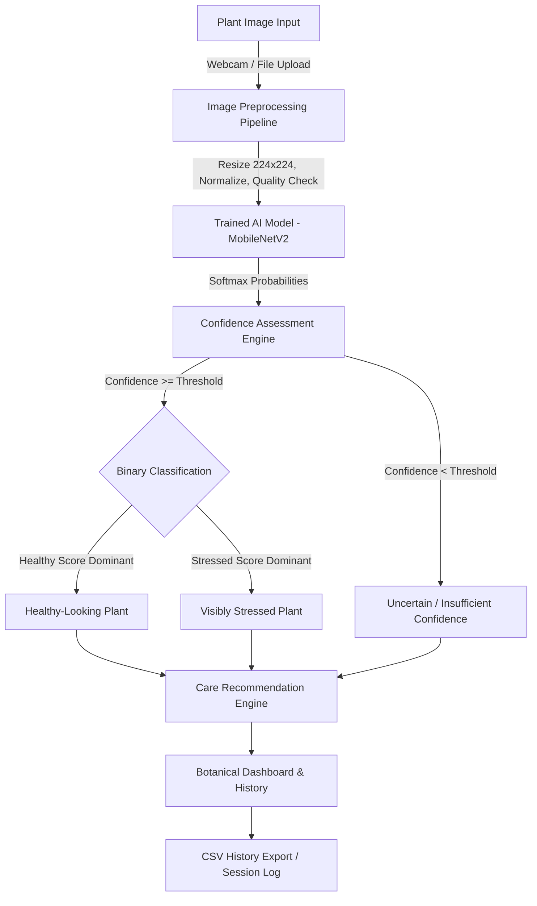

# SPROUT AI — Architectural Blueprint & Implementation Plan
**AI-Powered Plant Care Assistant for College Design Thinking & Methodology**

---

## 1. Executive Summary & Objective

**SPROUT AI** is an engineering prototype and zero-budget, camera-based plant-care assistant designed to bridge the gap between amateur plant owners and practical botany. Built specifically for a **college Design Thinking and Methodology (DTM)** project, it adheres to the following core tenets:
- **Zero-Cost & Local Execution**: Runs entirely on a standard student laptop without requiring paid APIs, cloud services, GPUs, Arduino/ESP32, or external hardware sensors.
- **Genuine Machine Learning**: Employs transfer learning (MobileNetV2 / lightweight CNN) with calibrated softmax confidence scoring, honest uncertainty rejection thresholds, and reproducible metrics.
- **Dual Input Modes**: File upload (PNG/JPG/WEBP) and live laptop webcam capture using Streamlit's native camera input.
- **Empathetic & Responsible Recommendations**: Delivers actionable plant care steps while explicitly cautioning that visible symptoms cannot substitute for physical soil moisture probes or lab-grade pathology.
- **Design Thinking Integration**: Embedded 5-stage DTM framework (Empathise, Define, Ideate, Prototype, Test) with editable sections and one-click report generation.

---

## 2. System Architecture & Workflow



---

## 3. Technology Stack & Environment

| Component | Selected Technology | Rationale |
| :--- | :--- | :--- |
| **Runtime** | Python 3.11.15 (`.venv311`) | Maximally compatible across ML packages without Windows binary wheel friction |
| **UI Framework** | Streamlit | Rapid interactive prototyping, native webcam support (`st.camera_input`), intuitive tabbed/multi-page layout |
| **ML Framework** | PyTorch & Torchvision (CPU) | High-speed inference on standard laptop CPUs, MobileNetV2 architecture, transparent training loops |
| **Image Processing** | Pillow (PIL) & OpenCV (`cv2`) | Standard RGB conversion, EXIF orientation correction, dimension normalization, image quality diagnostics |
| **Analytics & Metrics** | Scikit-Learn, Pandas, Seaborn | Honest classification metrics (Accuracy, Precision, Recall, F1), Confusion Matrix visualization, CSV generation |
| **Design System** | Custom CSS ("Botanical Glassmorphism") | Forest-green accents (`#1E3F20`), Sage highlights (`#4E9F3D`), clean whites (`#FFFFFF`), rounded card surfaces |

---

## 4. Detailed Component Breakdown

### A. Image Input & Preprocessing Pipeline (`predict.py`, `app.py`)
- **Supported Formats**: JPEG, JPG, PNG, WEBP.
- **Inputs**:
  1. Direct file uploader with drag-and-drop.
  2. Live laptop webcam capture (`st.camera_input`) with instant preview.
- **Preprocessing Steps**:
  - Image validation (integrity check, dimension check).
  - EXIF orientation correction to prevent upside-down webcam photos.
  - Aspect-ratio preserving square crop/padding to 224×224 pixels.
  - ImageNet normalization (`mean=[0.485, 0.456, 0.406]`, `std=[0.229, 0.224, 0.225]`).

### B. Machine Learning & Training Pipeline (`train_model.py`, `model_utils.py`)
- **Model Architecture**: MobileNetV2 (fine-tuned) with a custom dropout classification head:
  - `Linear(1280, 256) -> ReLU -> Dropout(0.3) -> Linear(256, 2)`.
- **Classes**:
  - `0: healthy` (Healthy-looking foliage, normal turgor, uniform chlorophyll)
  - `1: stressed` (Visible chlorosis, necrosis, leaf spots, wilting, drooping)
- **Training Workflow**:
  - Reads from `dataset/healthy/` and `dataset/stressed/`.
  - Realistic data augmentation: Random horizontal flips, rotation (±15°), color jitter (brightness/contrast).
  - Stratified 80/20 train/validation split.
  - Binary Cross-Entropy with Logits / Cross-Entropy Loss + Adam optimizer with learning rate scheduler.
  - Early stopping tracking validation loss to prevent overfitting.
  - Model weights saved to `models/sprout_model.pth` alongside metadata in `models/model_metadata.json`.
- **Sample Seed Dataset**: Included starter images for both healthy and stressed plants to enable immediate out-of-the-box demonstration.

### C. Calibrated Prediction & Uncertainty Logic (`predict.py`)
- **Probability Scoring**: Computes softmax probabilities $P(\text{healthy})$ and $P(\text{stressed})$.
- **Adjustable Confidence Threshold**: Defaults to **70% (0.70)**:
  - If $\max(P) \ge \text{Threshold}$: Returns the dominant category (`Healthy` or `Visibly Stressed`).
  - If $\max(P) < \text{Threshold}$: Returns `Uncertain / Insufficient Confidence`.
- **Image Quality Warnings**: Flags blurry or extreme brightness/darkness inputs and provides transparent feedback to the user.

### D. Plant-Care Recommendation Engine (`recommendations.py`)
- **Healthy-Looking Plant**:
  - Routine maintenance guidance (light rotation, dusting leaves, observing new growth).
  - Preventive monitoring checklist.
- **Visibly Stressed Plant**:
  - Step-by-step diagnostic triage:
    1. **Soil Moisture Check**: The 2-inch knuckle test (never blindly add water).
    2. **Sunlight & Environment**: Checking for scorch vs low-light stretching (etiolation).
    3. **Drainage & Root Health**: Verifying drainage holes, standing saucer water, odor.
    4. **Pest & Foliage Inspection**: Underside leaf examination for mites, aphids, fungal powdery spots.
- **Uncertain Category**:
  - Instructions to capture a close-up leaf shot in diffuse natural lighting against a neutral background.
  - Prompts to conduct manual tactile inspection.
- **Botanical Honesty Disclaimer**: Prominent reminder that computer vision on surface leaves cannot detect subterranean root rot or precise nutrient deficiencies without physical tests.

### E. User Interface & Pages (`app.py`)
Organized into an intuitive, polished navigation structure:
1. 🌱 **Home / Plant Analysis**: Dual input, real-time preview, instant classification card, confidence progress bar, tailored recommendations, reset button.
2. 📜 **Session History**: Table and cards of all plants diagnosed during the current session, downloadable as CSV.
3. 🏋️ **Model Training**: In-app dataset viewer, image counter, training parameters (epochs, learning rate), live training progress bar, epoch loss/accuracy curves.
4. 🧪 **Model Evaluation & Testing**: Test-set uploader, ground truth label comparison, Confusion Matrix plot, Accuracy/Precision/Recall/F1 table, and CSV export.
5. 💡 **Design Thinking Report**: Dedicated 5-stage DTM document (Empathise, Define, Ideate, Prototype, Test) with problem statement, persona quotes, editable student notes, and markdown report exporter.
6. ℹ️ **About & College Demo Guide**: System architecture diagram, hardware specifications, viva presentation checklist, FAQs.

---

## 5. Execution Roadmap

```
[Phase 1] Environment & Package Setup (.venv311 + PyTorch + Streamlit + OpenCV)
   └── Verify all packages import cleanly without native binary conflicts.

[Phase 2] Directory Layout & Seed Dataset Preparation
   └── Create sprout_ai/ folders and populate initial starter images.

[Phase 3] Core Machine Learning Modules
   ├── model_utils.py (MobileNetV2 definition & weights loader)
   ├── train_model.py (Dataset loader, augmentations, training loop, model saving)
   ├── predict.py (Preprocessing, inference, confidence thresholding)
   ├── recommendations.py (Care rule engine with botanical honesty)
   └── evaluation.py (Confusion matrix, classification metrics, CSV report)

[Phase 4] Streamlit Application & Botanical UI
   ├── Custom CSS styling (forest green, modern typography, glassmorphism)
   ├── Tab 1: Live Diagnosis & Webcam
   ├── Tab 2: Session History & CSV Export
   ├── Tab 3: Model Training UI
   ├── Tab 4: Evaluation & Testing Benchmark
   ├── Tab 5: Design Thinking 5-Stage Documentation
   └── Tab 6: About & College Presentation Checklist

[Phase 5] Starter Model Training & Verification
   └── Run train_model.py on seed dataset to produce models/sprout_model.pth.

[Phase 6] End-to-End Testing & Validation
   ├── Test upload inference
   ├── Test low-confidence thresholding
   ├── Test evaluation metrics calculation
   └── Test report export

[Phase 7] Comprehensive Documentation & Demo Script
   ├── README.md with college evaluator Q&A and viva guide
   └── run_sprout.bat one-click Windows launcher
```

---

## 6. College Viva / Presentation Preparedness

- **Design Thinking Problem Statement**:
  > *"How might we help students, beginners, and plant owners recognise visible signs of plant stress and make better plant-care decisions through an affordable, easy-to-use AI assistant?"*
- **Key Defense Points**:
  1. *Why transfer learning?* MobileNetV2 uses depthwise separable convolutions, offering 90%+ parameter reduction compared to VGG/ResNet while executing in <100ms on a laptop CPU.
  2. *Why confidence thresholding?* Real-world engineering requires models to declare "I don't know" rather than hallucinating answers when presented with out-of-distribution photos.
  3. *Why zero-budget?* Eliminates expensive cloud APIs and proprietary sensors, proving high social impact with existing student hardware.
